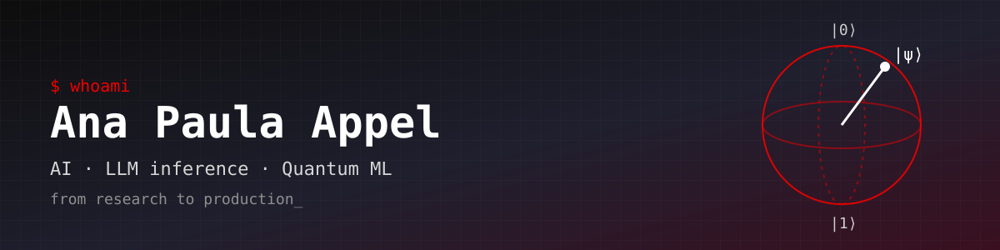

<div align="center">
  
  <br/>
</div>

Olá! Hi there! 👋

I'm a **Senior AI Specialist Solutions Architect at Red Hat**. I take machine learning from research to production (LLMs, RAG, agentic systems) and spend the rest of my time on **quantum machine learning**.

### ⚛️ `|STACK⟩` [Tech Stack]

<p align="center">
  <a href="https://skillicons.dev">
    
  </a>
</p>

### 📊 `MEASUREMENT` [Stats]


<br/>

### 📡 `ENTANGLED_CHANNELS`

```bash
$ ping anapaulaappel

PING anapaulaappel (127.0.0.1): 56 data bytes
64 bytes from 127.0.0.1: icmp_seq=0 ttl=64 time=0.042 ms

# Incoming message...
> Site:     anapaulaappel.github.io
> LinkedIn: linkedin.com/in/paulinhaappel
> YouTube:  youtube.com/@anaappel  (Vem Que Eu Te Explico)
```

<div align="center">
  <i>"Vem que eu te explico." 💡</i>
</div>
